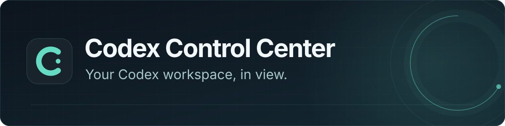
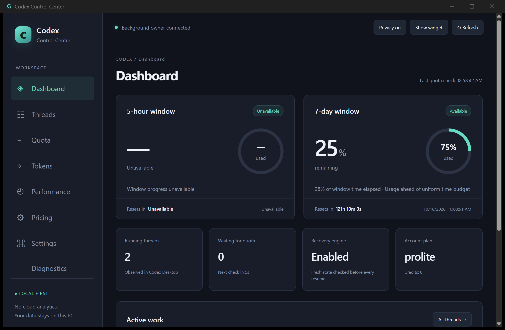

<div align="center">



<p><a href="README.md">简体中文</a> · <strong>English</strong></p>

<p>
  <a href="https://github.com/xdcgh/codex-control-center/releases/tag/v0.1.0"></a>
  <a href="docs/build.md"></a>
  <a href="https://github.com/xdcgh/codex-control-center/actions/workflows/ci.yml"></a>
  <a href="README.md"></a>
  <a href="LICENSE"></a>
</p>

<p><strong>A local-first Windows control center for Codex quota, tasks and observations.</strong></p>

<p>
  <a href="https://github.com/xdcgh/codex-control-center/releases/download/v0.1.0/Codex-Control-Center_0.1.0_x64-setup.exe"><strong>Windows installer</strong></a> ·
  <a href="https://github.com/xdcgh/codex-control-center/releases/download/v0.1.0/Codex-Control-Center_0.1.0_windows-x64-portable.zip"><strong>Portable ZIP</strong></a> ·
  <a href="https://github.com/xdcgh/codex-control-center/releases/download/v0.1.0/SHA256SUMS.txt">SHA256 checksums</a> ·
  <a href="https://github.com/xdcgh/codex-control-center/releases/tag/v0.1.0">Release notes</a>
</p>

<sub>Unofficial; not affiliated with OpenAI · Application analytics stay on your PC; no application telemetry is sent</sub>

</div>

## The actual app



<sub>Captured from an installed Windows build. Values reflect only that observation. <a href="docs/screenshots/dashboard-zh-CN.png">View the Chinese interface →</a></sub>

## Six views. One control center.

<table>
  <tr>
    <td><strong>◈ Quota &amp; recovery</strong><br />Observe real limits and reset times. Resume eligible original tasks after fresh-state checks.</td>
    <td><strong>☷ Threads &amp; Goals</strong><br />Keep the original thread, Goal and budget. Manage the queue with priority, reserve and concurrency controls.</td>
  </tr>
  <tr>
    <td><strong>◇ Tokens &amp; estimates</strong><br />View official account activity separately from local ledgers. Estimate API-equivalent costs with versioned pricing.</td>
    <td><strong>◴ Performance &amp; activity</strong><br />Explore observed turn performance and tool activity. Missing coverage is explicitly unavailable.</td>
  </tr>
  <tr>
    <td><strong>⌘ Tray &amp; widget</strong><br />Keep status close without leaving the main window open. Use system-language selection or a manual override.</td>
    <td><strong>⚙ Diagnostics &amp; controls</strong><br />Inspect data sources and compatibility. Manage recovery, notifications, privacy and database backups.</td>
  </tr>
</table>

> API-equivalent estimates are not Codex subscription bills. Unknown versions remain read-only; missing data stays Partial or Unavailable.

## Start in three steps

1. **Download and verify** — Choose the Windows x64 installer or portable ZIP above. Check the file against `SHA256SUMS.txt`.
2. **Install or extract** — Run the installer, or extract the complete portable folder and launch its app. The runtime includes Node; no development toolchain is needed.
3. **Connect your existing Codex** — Open Codex Desktop and sign in, then launch the control center. The interface follows Windows language settings by default; enable automatic recovery in Settings when needed.

This is an **unsigned preview**. When migrating an existing watchdog, follow the [migration guide](docs/baseline.md) first and retain a single background execution owner.

## Documentation & help

**Usage & security** · [Release notes](https://github.com/xdcgh/codex-control-center/releases/tag/v0.1.0) · [Security policy](SECURITY.md) · [Report an issue](https://github.com/xdcgh/codex-control-center/issues)

**Explore the project** · [Roadmap](ROADMAP.md) · [Progress](PROGRESS.md) · [Validation](docs/validation.md) · [Requirement audit](docs/acceptance-audit.md)

**Development** · [Windows builds](docs/build.md) · [Architecture](docs/adr/001-desktop-stack.md) · [Migration baseline](docs/baseline.md) · [Third-party notices](THIRD_PARTY_NOTICES.md)

<details>
<summary><strong>Development & technical design</strong></summary>

Tauri 2 / Rust handles windows, tray, notifications and startup; React / TypeScript provides the interface. Node.js 24 and SQLite retain the verified recovery core. Use the repository lockfiles:

```powershell
npm ci
npm run ui:build
```

See [Windows build instructions](docs/build.md) for native builds and the protected test-helper setup required by `npm test`. Development needs Node.js 24+, Rust, MSVC / Windows SDK and WebView2; end users do not need to install Node or Rust separately.

Core v2 checks real quota every **10 seconds** by default and samples quota history independently every **60 seconds**, without an added reset buffer. All blocking windows must be available. Fresh Thread / Goal checks and a durable send ledger prevent unsafe repeat dispatch. Manual pauses, budget limits and user-decision boundaries remain effective.

Official app-server reads take priority. Continuing an original thread uses isolated, version-verified Desktop IPC; unknown versions keep read-only monitoring available and disable unverified writes. The retained engine is in `src/`, and tests are in `test/`. The [historical watchdog guide](docs/legacy-watchdog.md) documents earlier behavior, including its reset buffer.

A gap between a tool request and its output means a pending request, not authoritative execution. Inactivity hints are heuristic and never initiate recovery. Official account activity is not merged with local token ledgers; raw speed values are not claimed as served service tiers or model decode speed.

Source and packages exclude user runtime, sessions, authentication files and private threads. Portable builds still keep application data in the user's local profile.

</details>

<details>
<summary><strong>Preview validation & accepted evidence limits</strong></summary>

These results belong to packaged source checkpoint **`704b256`**, not to future commits:

- The Windows Node suite passed **199/199**, with no failures or skips. Core and Windows packaging CI passed for that source.
- The actual installed and extracted portable payloads passed strict **45-file** comparisons, checksum verification and private-path scans.
- 598 Chinese/English catalog entries. New Diagnostics, official account activity, current Goal, tool activity and About pages were visually reviewed in both languages; installed tray navigation was exercised.
- The complete natural quota cycle through final task completion remains unproven. Windows stored TEST notifications, but visible popup presentation was not observed. The project owner accepted both as preview evidence limits, **not as passes**.
- Physical Windows reboot work is deferred to the next version at the user's direction.

Fixtures, live Desktop checks, package verification and natural cycles are distinct evidence. This preview does not claim full production acceptance. See [validation](docs/validation.md) and the [complete requirement audit](docs/acceptance-audit.md).

</details>

---

<div align="center">
  <sub>Developed by <strong>xudc2</strong> and <strong>Codex</strong> · <a href="LICENSE">MIT License</a><br />An independent open-source project, not affiliated with OpenAI.</sub>
</div>
