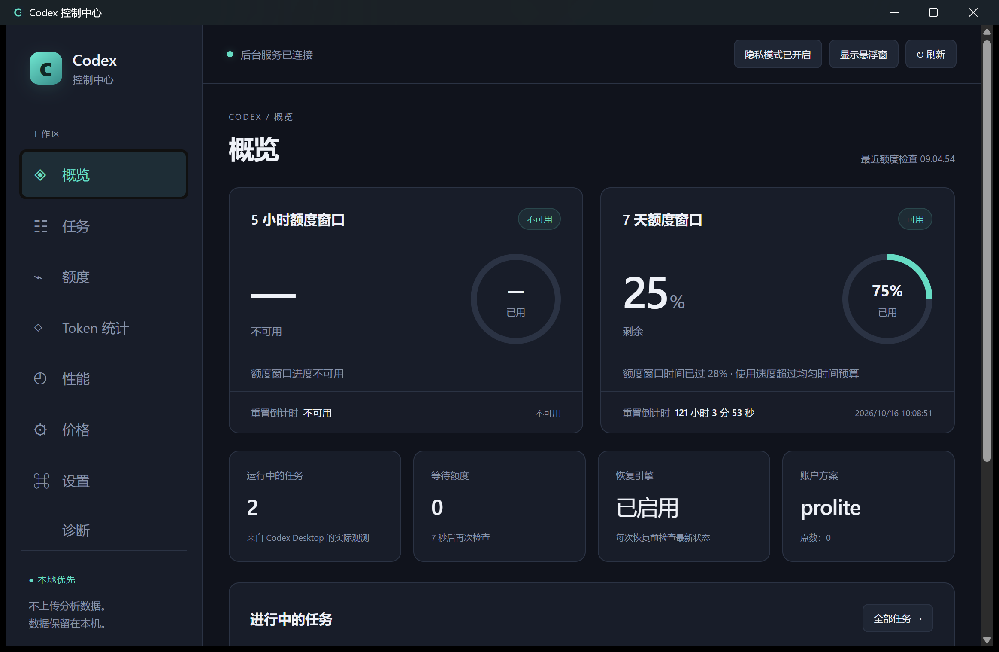

<div align="center">


<p><strong>简体中文</strong> · <a href="README.en.md">English</a></p>

<p>
  <a href="https://github.com/xdcgh/codex-control-center/releases/tag/v0.1.0"></a>
  <a href="docs/build.md"></a>
  <a href="https://github.com/xdcgh/codex-control-center/actions/workflows/ci.yml"></a>
  <a href="README.en.md"></a>
  <a href="LICENSE"></a>
</p>

<p><strong>一个本地优先的 Windows 控制中心，管理 Codex 额度、任务与观测数据。</strong></p>

<p>
  <a href="https://github.com/xdcgh/codex-control-center/releases/download/v0.1.0/Codex-Control-Center_0.1.0_x64-setup.exe"><strong>下载安装包</strong></a> ·
  <a href="https://github.com/xdcgh/codex-control-center/releases/download/v0.1.0/Codex-Control-Center_0.1.0_windows-x64-portable.zip"><strong>便携 ZIP</strong></a> ·
  <a href="https://github.com/xdcgh/codex-control-center/releases/download/v0.1.0/SHA256SUMS.txt">SHA256 校验</a> ·
  <a href="https://github.com/xdcgh/codex-control-center/releases/tag/v0.1.0">发布说明</a>
</p>

<sub>非官方项目，与 OpenAI 无关联 · 应用分析数据保存在本机，不发送应用遥测</sub>

</div>

## 实际界面



<sub>来自实际安装的 Windows 版本，数值仅代表截图时刻的观测。<a href="docs/screenshots/dashboard-en.png">查看英文界面 →</a></sub>

## 六个视角，一个控制中心

<table>
  <tr>
    <td><strong>◈ 额度与恢复</strong><br />查看真实额度及重置时间，检查最新状态后恢复符合条件的原任务。</td>
    <td><strong>☷ Thread 与 Goal</strong><br />保留原线程、目标和预算，用优先级、预留额度与并发限制管理队列。</td>
  </tr>
  <tr>
    <td><strong>◇ Token 与费用</strong><br />分开展示官方账户活动与本地账本，使用带版本的价格快照估算 API 等价费用。</td>
    <td><strong>◴ 性能与活动</strong><br />查看实际轮次性能与工具活动；缺少覆盖时明确显示不可用。</td>
  </tr>
  <tr>
    <td><strong>⌘ 托盘与悬浮窗</strong><br />无需一直打开主窗口。简体中文与英文随系统切换，也可手动选择。</td>
    <td><strong>⚙ 诊断与控制</strong><br />查看数据来源与兼容性，管理自动恢复、通知、隐私及数据库备份。</td>
  </tr>
</table>

> API 等价费用不是 Codex 订阅账单。未知版本保持只读；缺失数据保持“部分可用”或“不可用”。

## 三步开始

1. **下载与校验** — 从上方选择 Windows x64 安装包或便携 ZIP，使用 `SHA256SUMS.txt` 核对文件。
2. **安装或解压** — 运行安装包；便携版解压完整目录后启动其中的应用。运行版已附带 Node，无需安装开发工具链。
3. **连接现有 Codex** — 打开并登录 Codex Desktop，再启动控制中心。界面默认跟随 Windows 语言；在设置中按需开启自动恢复。

当前为**未签名的预览版**。迁移旧 watchdog 时，请先按[迁移指南](docs/baseline.md)完成安全交接，保留单一后台执行者。

## 文档与帮助

**使用与安全** · [发布说明](https://github.com/xdcgh/codex-control-center/releases/tag/v0.1.0) · [安全策略](SECURITY.md) · [问题反馈](https://github.com/xdcgh/codex-control-center/issues)

**了解项目** · [路线图](ROADMAP.md) · [进度记录](PROGRESS.md) · [验证记录](docs/validation.md) · [完整需求验收](docs/acceptance-audit.md)

**参与开发** · [Windows 构建](docs/build.md) · [架构决策](docs/adr/001-desktop-stack.md) · [迁移基线](docs/baseline.md) · [第三方声明](THIRD_PARTY_NOTICES.md)

<details>
<summary><strong>开发与技术设计</strong></summary>

Tauri 2 / Rust 负责窗口、托盘、通知与启动，React / TypeScript 提供界面；Node.js 24 与 SQLite 保留经过验证的恢复核心。使用仓库锁文件：

```powershell
npm ci
npm run ui:build
```

完整原生构建和 `npm test` 的受保护测试助手配置见[Windows 构建说明](docs/build.md)。开发需要 Node.js 24+、Rust、MSVC / Windows SDK 与 WebView2；这些是开发要求，不是要求使用者自行安装 Node 或 Rust。

Core v2 默认每 **10 秒**检查实际额度，每 **60 秒**独立保存额度历史，不再增加固定重置等待。所有阻塞窗口必须可用，发送前重新检查 Thread / Goal；持久化发送记录防止不安全的重复恢复。手动暂停、预算与用户决策边界保持有效。

官方 app-server 读取优先。原线程继续执行使用隔离、版本验证的 Desktop IPC；未知版本继续只读监控并禁用未验证的写入。原恢复引擎在 `src/`，测试在 `test/`；旧版行为及其重置缓冲记录在[历史 watchdog 指南](docs/legacy-watchdog.md)。

工具请求与输出之间的间隙仅代表待返回请求，不等于权威执行状态。长时间无新事件的提示属于启发式，不会触发恢复。账户活动不与本地 Token 账本合并；原始速度字段也不被当作实际服务档位或模型解码速度。

源码与发布包不包含用户运行状态、会话、认证文件或私密线程。便携版仍将应用数据保存在用户本地配置目录。

</details>

<details>
<summary><strong>预览版验证范围与已接受的证据边界</strong></summary>

以下结果属于发布包源码检查点 **`704b256`**，不是对未来提交的验证承诺：

- Windows Node 测试 **199/199** 通过，无失败、无跳过；该源码的 Core 与 Windows 包 CI 均通过。
- 实际安装版与解压后的便携版通过 **45 文件**严格核对，发布文件完成校验与私密路径扫描。
- 598 个中英文文案键；新增诊断、官方账户活动、当前 Goal、工具活动及 About 页面完成双语安装版视查，托盘导航已实际操作。
- 真实额度恢复到原任务最终完成的完整自然周期，仍未取得终态证据。Windows 已存储测试通知，但可见弹窗未被观测。项目负责人接受这两项作为本版证据边界，**不将其记作通过**。
- 按用户要求，实际 Windows 重启相关工作留到下一版。

测试夹具、真实 Desktop 检查、安装包验证与自然周期是不同证据。本预览版不宣称完成全部生产环境验收。详见[验证记录](docs/validation.md)与[完整需求验收](docs/acceptance-audit.md)。

</details>

---

<div align="center">
  <sub>由 <strong>xudc2</strong> 与 <strong>Codex</strong> 开发 · <a href="LICENSE">MIT License</a><br />独立的开源项目，与 OpenAI 无关联。</sub>
</div>
